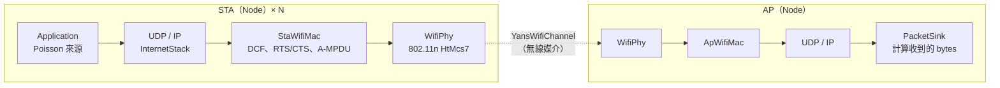

# ns-3 功能與基本安裝使用說明（作業一）

> **ns-3 是開源的離散事件網路模擬器：用 C++ 把節點、網卡、通道、協定堆疊和應用程式組成一個虛擬網路，跑完後輸出封包層級的統計結果。** 作業一用它模擬 802.11n 的 DCF（CSMA/CA），量測不同 STA 數、到達率、RTS/CTS 設定下的 throughput。

- **離散事件**：模擬器只處理「事件」（封包送出、退避倒數結束、ACK 逾時…），事件之間直接跳過，所以 20 秒的模擬幾秒內就跑完，而且結果可重現。
- **協定細節完整**：802.11 的 IFS、退避、ACK、RTS/CTS、NAV、A-MPDU、Block Ack 都照標準實作，不是用公式近似。
- **開源免費**：GPLv2 授權，原始碼在 <https://gitlab.com/nsnam/ns-3-dev>，官方文件在 <https://www.nsnam.org/documentation/>。
- **不是 ns-2 的新版**：ns-3 從頭重寫，和 ns-2 的 Tcl 腳本不相容。

本份作業使用的環境：

| 項目 | 版本 |
|---|---|
| 系統 | Windows 11 + WSL2 Ubuntu 24.04.2 LTS |
| ns-3 | ns-3.49（optimized 建置） |
| 編譯器／建置工具 | g++ 13.3、CMake 3.28、Ninja |
| 畫圖 | Python 3 + pandas + matplotlib |

---

## 1. ns-3 的主要功能

### 1.1 模組

ns-3 由許多模組組成（原始碼在 `src/` 下），需要哪些就啟用哪些。

| 模組 | 功能 | 作業一有沒有用 |
|---|---|---|
| `core` | 模擬器核心：事件排程、時間、亂數、屬性系統、log | ✔（一定會載入） |
| `network` | Node、Packet、Socket、位址等基本型別 | ✔（一定會載入） |
| `wifi` | IEEE 802.11 a/b/g/n/ac/ax/be 的 MAC 與 PHY | ✔ 主角 |
| `internet` | IPv4／IPv6、UDP、TCP、路由 | ✔ UDP |
| `applications` | 流量產生器（OnOff、BulkSend、UdpClient）、PacketSink | ✔ PacketSink |
| `mobility` | 節點位置與移動模型 | ✔ 固定位置 |
| `propagation` | 路徑損耗、衰落模型 | ✔（wifi 自動帶入） |
| `stats` | 統計收集、Gnuplot 輸出 | 已啟用，未直接使用 |
| `flow-monitor` | 每條 flow 的 throughput、延遲、遺失率（輸出 XML） | 未啟用 |
| `netanim` | 產生封包流動動畫的 XML，用 NetAnim 程式播放 | 未啟用 |
| `lte`、`lr-wpan`、`csma`、`point-to-point`、`mesh`… | 其他網路技術 | 未使用 |

### 1.2 Wi-Fi 模組能模擬什麼

| 功能 | 說明 | 對應課程 |
|---|---|---|
| 標準 | `WIFI_STANDARD_80211a/b/g/n/ac/ax/be` 一行切換 | 2-1 PHY 演進 |
| 存取機制 | DCF／EDCA：DIFS（AIFS）、隨機退避、二元指數退避、ACK、重傳上限 | 2-4 DCF |
| RTS/CTS | 用 `RtsCtsThreshold` 控制，NAV 依 Duration 欄位更新 | 2-4 Hidden node |
| 聚合 | A-MPDU、A-MSDU、Block Ack | 802.11n |
| 速率控制 | `ConstantRateWifiManager`（固定速率）、`MinstrelHtWifiManager`、`IdealWifiManager` 等 | 2-1 速率切換 |
| PHY 模型 | `YansWifiPhy`（簡單、快）、`SpectrumWifiPhy`（考慮頻譜重疊、OFDMA） | 2-1 PHY |
| 通道 | 傳播延遲＋路徑損耗（預設 LogDistance），可換其他模型 | 2-1 無線環境 |
| 拓樸 | AP＋STA（Infrastructure）、ad hoc、mesh | 2-1、2-2 架構 |

### 1.3 結果輸出與分析工具

| 工具 | 輸出 | 用途 |
|---|---|---|
| Application 計數器（如 `PacketSink::GetTotalRx()`） | 程式內的數字 | 算 throughput（作業一用這個） |
| Trace source（`Config::Connect`） | 自訂 callback | 監聽 MAC 碰撞、重傳、PHY 收發等事件 |
| PCAP | `.pcap` 檔 | 用 Wireshark 看每個 802.11 訊框 |
| ASCII trace | `.tr` 文字檔 | 逐行列出封包事件 |
| FlowMonitor | XML | 每條 flow 的延遲、遺失率 |
| NetAnim | XML 動畫 | 看封包在節點間流動 |
| `NS_LOG` | 終端機文字 | 除錯用，印出模組內部的流程 |

ns-3 本身不太畫圖，一般做法是輸出 CSV，再用 Python 或 gnuplot 畫（作業一的做法見 [`ns3-hw1.md` 第 4 節](ns3-hw1.md#4-畫圖)）。

---

## 2. 核心概念

ns-3 的程式就是用下面這些「積木」搭出一個網路，再交給 `Simulator` 執行。

| 概念 | 是什麼 | 真實世界的對應 | 作業一 `hw1.cc` 裡的寫法 |
|---|---|---|---|
| **Node** | 一台裝置的空殼 | 電腦、手機、AP | `NodeContainer apNode, staNodes` |
| **NetDevice** | 網卡（含 MAC 與 PHY） | Wi-Fi 網卡 | `wifi.Install(phy, mac, staNodes)` |
| **Channel** | 連接網卡的媒介 | 空氣中的電波 | `YansWifiChannelHelper::Default()` |
| **Protocol stack** | IP、UDP、TCP | 作業系統的網路堆疊 | `InternetStackHelper` |
| **Application** | 產生或接收流量的程式 | 使用者程式 | STA 上的 Poisson 來源、AP 上的 `PacketSink` |
| **Mobility** | 節點位置 | 實際擺放位置 | `ListPositionAllocator`（半徑 5 m 的圓） |
| **Helper** | 一次幫多個節點安裝、設定的工具類別 | — | `WifiHelper`、`WifiMacHelper`、`YansWifiPhyHelper` |
| **Attribute** | 物件的可調參數，可用字串設定 | 設定頁面上的選項 | `"RtsCtsThreshold"`、`"DataMode"`、`"ChannelSettings"` |
| **Simulator** | 事件排程與執行 | 時間本身 | `Simulator::Schedule`、`Run`、`Stop`、`Destroy` |



一個 ns-3 程式的固定步驟：

1. 建 **Node**。
2. 設定 **Channel** 與 **PHY**。
3. 設定 **MAC** 與標準，用 Helper 安裝成 **NetDevice**。
4. 設定 **Mobility**（位置）。
5. 安裝 **Internet stack**、分配 IP。
6. 安裝 **Application**（流量來源與接收端），設定開始與結束時間。
7. `Simulator::Run()` 執行，`Simulator::Destroy()` 收尾。
8. 讀出統計值並輸出。

---

## 3. 安裝

### 3.1 Windows：先裝 WSL2

ns-3 只支援 Linux 與 macOS，Windows 要透過 WSL2 執行。

```powershell
# PowerShell（系統管理員）
wsl --install -d Ubuntu
```

重新開機後打開「Ubuntu」，設定使用者名稱與密碼。之後的指令都在 Ubuntu 裡執行。

### 3.2 安裝相依套件

```bash
sudo apt update
sudo apt install -y g++ cmake ninja-build python3 python3-pip git
sudo apt install -y python3-pandas python3-matplotlib    # 畫圖用
```

選用：`gnuplot`（ns-3 的 Gnuplot 輸出）、`wireshark`（看 pcap）、`gdb`（除錯）。

### 3.3 下載 ns-3

```bash
cd ~
git clone https://gitlab.com/nsnam/ns-3-dev.git
cd ns-3-dev
git checkout ns-3.49        # 固定版本，結果才能重現
```

也可以從官網下載 release 壓縮檔（`ns-allinone-3.xx.tar.bz2`），解壓後進入 `ns-3.xx/` 目錄，步驟相同。

### 3.4 設定與編譯

```bash
# 作業一用的設定：optimized（執行快），只開需要的模組（編譯快）
./ns3 configure --build-profile=optimized \
    --enable-modules='wifi;applications;internet;mobility;stats'
./ns3 build
```

| 建置設定（`--build-profile`） | 特性 | 適合 |
|---|---|---|
| `debug` | 有除錯資訊、`NS_LOG` 與 assert 都開，執行最慢 | 開發、找錯 |
| `default` | 介於兩者之間 | 一般學習 |
| `optimized` | 編譯器最佳化、**`NS_LOG` 被關掉**，執行最快 | 正式跑大量模擬 |

想完整安裝、順便跑官方範例和測試：

```bash
./ns3 configure --enable-examples --enable-tests
./ns3 build
./test.py          # 跑全部單元測試，需要一段時間
```

### 3.5 確認安裝成功

```bash
./ns3 show version                    # 印出 "ns-3 version: ns-3.49"
./ns3 run scratch-simulator           # debug／default 建置會印出 "Scratch Simulator"
./ns3 run "hw1 --PrintHelp"           # 能列出參數表，表示 hw1.cc 已編譯成功
```

注意：optimized 建置會把 `NS_LOG_UNCOND` 一起關掉，所以 `scratch-simulator` 不會印字，只要沒有錯誤訊息就代表成功。

有開 `--enable-examples` 的話，也可以跑官方的 Wi-Fi 範例：

```bash
./ns3 run wifi-simple-infra
./ns3 run wifi-ht-network        # 802.11n 的 throughput 範例，和作業一最接近
```

---

## 4. 基本使用

### 4.1 寫自己的程式：放在 `scratch/`

`scratch/` 底下的 `.cc` 檔會自動被編譯，不必改 CMake 設定。

```bash
cp hw1.cc ~/ns-3-dev/scratch/
cd ~/ns-3-dev
./ns3 build                  # 只會重新編譯有改過的檔案
./ns3 run hw1                # 程式名稱 = 檔名去掉 .cc
```

### 4.2 傳參數：`CommandLine`

程式裡用 `cmd.AddValue("nSta", "Number of STAs", nSta)` 註冊參數，執行時用 `--名稱=值` 指定。**整串要用雙引號包起來**，否則 `./ns3` 會把參數當成自己的選項。

```bash
./ns3 run "hw1 --nSta=20 --rate=800 --rts=1"
./ns3 run "hw1 --PrintHelp"                      # 列出這個程式所有參數與預設值
```

`--PrintHelp` 的輸出（作業一）：

```text
Program Options:
    --nSta:         Number of STAs [5]
    --rate:         Arrival rate per STA (packets/s) [200]
    --rts:          Enable RTS/CTS [false]
    --ampdu:        Enable A-MPDU aggregation [true]
    --pktSize:      UDP payload size (bytes) [1472]
    --mcs:          HT MCS (e.g. HtMcs7) [HtMcs7]
    --cwMin:        Minimum contention window (BE) [15]
    --cwMax:        Maximum contention window (BE) [1023]
    --aifsn:        AIFSN of BE (DIFS = SIFS + aifsn * slot) [3]
    --printParams:  Print effective PHY/MAC parameters and frame airtimes [false]
    --simTime:      Simulation end time (s) [20]
    --run:          RNG run number [1]
    --out:          Output CSV file [results.csv]
```

### 4.3 查詢與設定 Attribute

每個 ns-3 類別都有一組 Attribute。忘了名稱或預設值時，直接問程式：

```bash
./ns3 run "hw1 --PrintAttributes=ns3::WifiRemoteStationManager"   # RtsCtsThreshold、FragmentationThreshold…
./ns3 run "hw1 --PrintAttributes=ns3::ConstantRateWifiManager"    # DataMode、ControlMode
./ns3 run "hw1 --PrintAttributes=ns3::WifiPhy"                    # ChannelSettings、Sifs、Slot…
./ns3 run "hw1 --PrintTypeIds"                                    # 列出所有類別
```

程式裡設定 Attribute 有三種方式：

```cpp
// 1. 透過 Helper（作業一的主要寫法）
wifi.SetRemoteStationManager("ns3::ConstantRateWifiManager",
                             "DataMode", StringValue("HtMcs7"),
                             "RtsCtsThreshold", UintegerValue(0));

// 2. 改某個類別所有之後建立的物件的預設值（要在建立物件之前呼叫）
Config::SetDefault("ns3::WifiRemoteStationManager::RtsCtsThreshold", UintegerValue(0));

// 3. 用路徑改已經建好的物件（作業一關 A-MPDU 用這個）
Config::Set("/NodeList/*/DeviceList/*/$ns3::WifiNetDevice/Mac/BE_MaxAmpduSize",
            UintegerValue(0));
```

### 4.4 排程事件

```cpp
Simulator::Schedule(Seconds(1.0), &PoissonSend, sock, size, iat, stop);  // 1 秒後呼叫函式
Simulator::Stop(Seconds(20.0));                                           // 20 秒時結束
Simulator::Run();                                                         // 開始執行
Simulator::Destroy();                                                     // 釋放資源
```

作業一的 Poisson 來源就是「送一個封包，再用 `Schedule` 排下一次送出，間隔取指數分布」，一直遞迴到結束時間。

### 4.5 亂數與重現性

ns-3 的亂數由 **seed** 和 **run** 兩個數字決定，兩者相同時結果完全相同。

```cpp
RngSeedManager::SetSeed(1);   // 固定 seed
RngSeedManager::SetRun(run);  // 換 run 編號 = 換一組獨立的亂數
```

作業一每組參數跑 run = 1、2、3 取平均，報告裡的數字都能重跑出一模一樣的結果。不寫程式時也可以用全域參數 `--RngRun=3`。

### 4.6 除錯：Log 與 PCAP

```bash
# Log：只有 debug 或 default 建置才有輸出（optimized 會把 NS_LOG 編譯掉）
NS_LOG="Hw1=level_all|prefix_time" ./ns3 run hw1
NS_LOG="WifiMac=level_debug" ./ns3 run hw1
```

```cpp
// PCAP：在程式裡加這兩行，跑完會產生 hw1-<node>-<device>.pcap，用 Wireshark 開
phy.SetPcapDataLinkType(WifiPhyHelper::DLT_IEEE802_11_RADIO);
phy.EnablePcap("hw1", apDev.Get(0));
```

在 Wireshark 裡可以直接看到 RTS、CTS、Data（A-MPDU）、Block Ack 的順序與 Duration 欄位，對照 2-3、2-4 章的訊框格式。

### 4.7 `./ns3` 常用指令

| 指令 | 用途 |
|---|---|
| `./ns3 configure [選項]` | 設定建置方式與要編譯的模組 |
| `./ns3 build` | 編譯（只編改過的檔案） |
| `./ns3 run "程式 --參數"` | 編譯後執行 |
| `./ns3 run --no-build "程式"` | 不檢查編譯直接執行（平行跑多組時用，避免同時編譯） |
| `./ns3 run 程式 --gdb` | 用 gdb 執行（需 debug 建置） |
| `./ns3 show profile` | 顯示目前的建置設定 |
| `./ns3 clean` | 刪除編譯產物 |

---

## 5. 作業一怎麼用 ns-3

### 5.1 對應關係

| 作業需求 | ns-3 的做法 |
|---|---|
| 802.11n | `wifi.SetStandard(WIFI_STANDARD_80211n)`，5 GHz、20 MHz、通道 36 |
| 固定傳輸速率 | `ConstantRateWifiManager`，`DataMode = HtMcs7`（65 Mbps） |
| RTS/CTS 開／關 | `RtsCtsThreshold = 0`（每個訊框都先 RTS）／`999999`（永遠不用） |
| STA 數 5、20 | `staNodes.Create(nSta)`，放在 AP 周圍半徑 5 m 的圓上 |
| Arrival rate 200、800 pkt/s | 每台 STA 一個 Poisson 來源，平均間隔 1／rate 秒 |
| Throughput | AP 上 `PacketSink` 在 2–20 s 收到的 bytes × 8 ÷ 18 s |
| 多次取平均 | `--run=1,2,3` |

DCF 參數在程式中明確設定（`--cwMin=15 --cwMax=1023 --aifsn=3`），加 `--printParams=1` 會印出實際生效的值：SIFS 16 µs、slot 9 µs、DIFS 43 µs、CW<sub>min</sub> 15、PLCP 36 µs，以及每種訊框的空中時間（例如 1538 B 資料訊框 228 µs）。

### 5.2 執行流程

```bash
# 1. 放檔案
cp hw1.cc ~/ns-3-dev/scratch/
cp run_all.sh plot.py ~/ns-3-dev/
cd ~/ns-3-dev

# 2. 跑一組確認
./ns3 run "hw1 --nSta=5 --rate=200 --rts=0"
# → nSta=5 rate=200 rts=0 offered=11.776 Mbps  throughput=... Mbps  loss=...

# 3. 跑全部組合（STA × rate × RTS × run，平行執行）
bash run_all.sh results.csv

# 4. 畫圖
python3 plot.py results.csv throughput_vs_rate.png
```

程式碼逐段說明、批次腳本與畫圖細節見 [`ns3-hw1.md`](ns3-hw1.md)；實驗設計與參數表見 [`hw1-spec.md`](hw1-spec.md)。

---

## 6. 常見問題

| 狀況 | 原因與解法 |
|---|---|
| `pip install` 出現 `externally-managed-environment` | Ubuntu 24.04 不讓 pip 裝到系統 Python。改用 `sudo apt install python3-pandas python3-matplotlib`，或建 venv。 |
| `./ns3 run hw1 --nSta=20` 參數沒作用 | 參數要和程式名稱一起用雙引號包住：`./ns3 run "hw1 --nSta=20"`。 |
| 設了 `NS_LOG` 卻沒有輸出 | optimized 建置把 log 編譯掉了。改用 `./ns3 configure --build-profile=debug` 重新編譯。 |
| 平行跑多組時一直重新編譯、互相卡住 | 先 `./ns3 build` 一次，之後每組用 `./ns3 run --no-build`。 |
| 從 Windows 的 Git Bash 呼叫 `wsl` 時路徑被改掉 | Git Bash 會自動轉換 `/` 開頭的路徑，指令前加 `MSYS_NO_PATHCONV=1`。 |
| `sudo` 要密碼，但在自動化腳本裡無法輸入 | 在 PowerShell 用 `wsl -d Ubuntu -u root <指令>` 以 root 身分執行。 |
| 改了 `hw1.cc` 結果沒變 | 改的是 repo 裡的檔案，要再 `cp` 到 `~/ns-3-dev/scratch/` 並重新 build。 |
| Throughput 是 0 | STA 還沒 associate 就開始送，或 sink 的 port 不對。作業一在 1 s 才開始送、2 s 才開始量。 |
