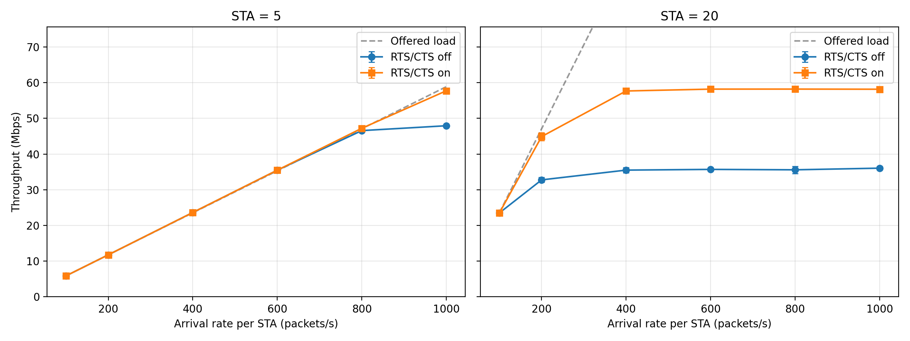
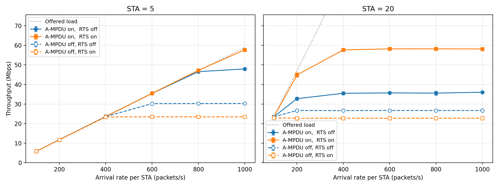
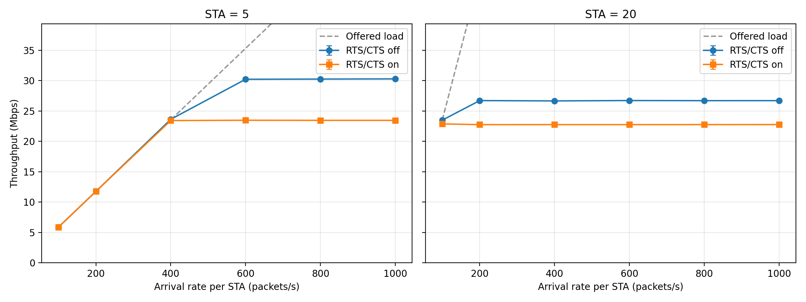

# 作業一補充（不在作業繳交範圍）

> **這份補充不屬於作業。** 作業報告只依題目 PPT 呈現：STA 5、20 × λ 200、800 packets/s × RTS/CTS 開關，共 8 組。以下是做作業時額外跑的實驗與分析，以及報告精簡時移出的段落（第 7 節），留作參考，報告裡不引用。

英文與縮寫名詞（Bianchi、T<sub>s</sub>、T<sub>c</sub>、A-MPDU 等）的意思見 [`../glossary.md`](../glossary.md)。

本資料夾的檔案：

| 檔案 | 內容 |
|---|---|
| `results_all_rates.csv` | 6 種 arrival rate（100–1000 packets/s）× 2 種 STA 數 × RTS 開關 × 3 個 seed，共 72 筆，A-MPDU 開 |
| `results_noampdu.csv` | 同上，A-MPDU 關 |
| `throughput_vs_rate_all_rates.png` | 6 種 arrival rate 的 Throughput vs. Arrival Rate（A-MPDU 開） |
| `throughput_vs_rate_noampdu.png` | 同上，A-MPDU 關 |
| `ampdu_compare.png` | A-MPDU 開關對照圖 |
| `plot_ampdu.py` | 畫 A-MPDU 開關對照圖 |
| `theory.py` | 單一 STA 無碰撞上限與 Bianchi 模型，和模擬飽和值對照 |

`results_all_rates.csv` 中 λ = 200、800 的 24 筆，與作業用的 `../results.csv` 完全相同。

---

## 1. 補點：arrival rate 100–1000 packets/s

作業只要求 200、800 packets/s。另外補了 100、400、600、1000，用來看出飽和點在哪裡。



| STA | λ（pkt/s） | 負載（Mbps） | RTS 關 throughput（Mbps） | RTS 關遺失率 | RTS 開 throughput（Mbps） | RTS 開遺失率 |
|---|---|---|---|---|---|---|
| 5 | 100 | 5.9 | 5.9 | 0% | 5.9 | 0% |
| 5 | 200 | 11.8 | 11.8 | 0% | 11.8 | 0% |
| 5 | 400 | 23.6 | 23.6 | 0% | 23.6 | 0% |
| 5 | 600 | 35.3 | 35.5 | 0% | 35.5 | 0% |
| 5 | 800 | 47.1 | 46.6 | 1.4% | 47.2 | 0% |
| 5 | 1000 | 58.9 | 47.9 | 18.7% | 57.7 | 2.1% |
| 20 | 100 | 23.6 | 23.5 | 0% | 23.5 | 0% |
| 20 | 200 | 47.1 | 32.8 | 30.3% | 44.9 | 4.5% |
| 20 | 400 | 94.2 | 35.5 | 62.2% | 57.7 | 38.7% |
| 20 | 600 | 141.3 | 35.7 | 74.7% | 58.2 | 58.7% |
| 20 | 800 | 188.4 | 35.6 | 81.1% | 58.2 | 69.1% |
| 20 | 1000 | 235.5 | 36.1 | 84.7% | 58.2 | 75.3% |

- **飽和點**：20 STA 在 RTS 關時 200 packets/s 就飽和，RTS 開時到 400 packets/s 才飽和；5 STA 要到 800–1000 packets/s。
- **飽和值**：A-MPDU 開時，RTS 關約 36 Mbps（20 STA）、48 Mbps（5 STA）；RTS 開兩者都約 58 Mbps。

---

## 2. A-MPDU 開關對照

關閉 A-MPDU（`--ampdu=0`）後，RTS/CTS 從「提高 60%」變成「降低 15–22%」，說明 RTS/CTS 的好處來自長訊框。



圖中顏色區分 RTS/CTS，實線為 A-MPDU 開、虛線為 A-MPDU 關。只看 A-MPDU 關的版本：



飽和 throughput（λ = 1000 packets/s，Mbps）：

| STA | A-MPDU 關、RTS 關 | A-MPDU 關、RTS 開 | A-MPDU 開、RTS 關 | A-MPDU 開、RTS 開 |
|---|---|---|---|---|
| 5 | 30.3 | 23.5（−22%） | 47.9 | 57.7（+20%） |
| 20 | 26.7 | 22.8（−15%） | 36.1 | 58.2（+61%） |

- **沒有 A-MPDU 時**，每個訊框只裝一個 1500 B 封包，在 65 Mbps 下約 0.2 ms。碰撞浪費的時間本來就短，RTS/CTS 省不到多少，每個訊框卻要多付 RTS + CTS + 2 個 SIFS，所以開了反而虧。
- **5 STA 虧得比 20 STA 多**：5 STA 碰撞少，RTS/CTS 幾乎只有開銷，還讓飽和提早。600 packets/s 時，開 RTS/CTS 只剩 23.5 Mbps（遺失率 33.8%），不開是 30.2 Mbps（遺失率 14.8%）。20 STA 碰撞多，RTS/CTS 稍微扳回一點。
- **A-MPDU 本身的效果**：5 STA、RTS 關時，飽和 throughput 從 30.3 提高到 47.9 Mbps。聚合讓多個封包共用一次 DIFS、退避、preamble 與 ACK，每個封包分攤的開銷大幅降低。
- **只有「A-MPDU 開 + RTS 開」不受 STA 數影響**：5 STA 與 20 STA 都約 58 Mbps，碰撞代價只剩一個 RTS。

---

## 3. 理論值對照

用題目參數算的理論飽和 throughput 和模擬相差 0–15%，趨勢一致：RTS/CTS 只有在 A-MPDU 開啟時才有利。

### 3.1 ns-3 實際的訊框空中時間

`hw1 --printParams=1` 印出（A-MPDU 開、RTS 開、5 STA、λ = 1000）：

```text
PLCP preamble+header (HT-MF, 1 SS) = 36us
  A-MPDU(QOSDATA): 43230 B (28 MPDU), HtMcs7, 5360us
  QOSDATA: 1538 B (1 MPDU), HtMcs7, 228us
  CTL_ACK: 14 B (1 MPDU), OfdmRate6Mbps, 44us
  CTL_BACKRESP: 32 B (1 MPDU), OfdmRate24Mbps, 32us
  CTL_RTS: 20 B (1 MPDU), HtMcs0, 64us
  CTL_CTS: 14 B (1 MPDU), OfdmRate6Mbps, 44us
```

A-MPDU 最多 28 個 MPDU，是因為 HT PPDU 的最長時間限制（約 5.484 ms）。

### 3.2 模型

**單一 STA 無碰撞上限**：每次傳送前平均退避 CW<sub>min</sub> / 2 = 7.5 個 slot。

```
S1 = k × 8L ÷ (CWmin/2 × σ + Ts)
```

**Bianchi 飽和模型**：每個 STA 都一直有封包要送；τ 是每個 slot 傳送的機率、p 是碰撞機率，W = CW<sub>min</sub> + 1 = 16、m = 6（CW<sub>max</sub> = 1023）。

```
τ = 2(1 − 2p) ÷ [(1 − 2p)(W + 1) + pW(1 − (2p)^m)]
p = 1 − (1 − τ)^(n−1)
P_tr = 1 − (1 − τ)^n
P_s  = nτ(1 − τ)^(n−1) ÷ P_tr
S = P_s P_tr × k × 8L ÷ [(1 − P_tr)σ + P_tr P_s Ts + P_tr(1 − P_s)Tc]
```

σ = 9 µs，L = 1472 B，k 是一次送出的 MPDU 數；碰撞後其他站台等 EIFS = SIFS + ACK + DIFS = 103 µs。

| 情況 | k | Ts（µs） | Tc（µs） |
|---|---|---|---|
| 無 A-MPDU、基本存取 | 1 | Data + SIFS + ACK + DIFS = 331 | Data + EIFS = 331 |
| 無 A-MPDU、RTS/CTS | 1 | RTS + SIFS + CTS + SIFS + 331 = 471 | RTS + EIFS = 167 |
| A-MPDU、基本存取 | 28 | A-MPDU + SIFS + BA + DIFS = 5451 | A-MPDU + EIFS = 5463 |
| A-MPDU、RTS/CTS | 28 | RTS + SIFS + CTS + SIFS + 5451 = 5591 | RTS + EIFS = 167 |

### 3.3 結果（模擬取 λ = 1000 packets/s，3 個 seed 平均）

| A-MPDU | RTS/CTS | STA | 碰撞機率 p | 單 STA 上限（Mbps） | Bianchi（Mbps） | 模擬（Mbps） | 模擬 − 理論 |
|---|---|---|---|---|---|---|---|
| 關 | 關 | 5 | 0.272 | 29.55 | 28.58 | 30.29 | +6.0% |
| 關 | 關 | 20 | 0.481 | 29.55 | 24.46 | 26.71 | +9.2% |
| 關 | 開 | 5 | 0.272 | 21.87 | 22.53 | 23.47 | +4.2% |
| 關 | 開 | 20 | 0.481 | 21.87 | 21.29 | 22.77 | +7.0% |
| 開 | 關 | 5 | 0.272 | 59.75 | 51.11 | 47.94 | −6.2% |
| 開 | 關 | 20 | 0.481 | 59.75 | 42.63 | 36.06 | −15.4% |
| 開 | 開 | 5 | 0.272 | 58.27 | 58.43 | 57.74 | −1.2% |
| 開 | 開 | 20 | 0.481 | 58.27 | 58.12 | 58.17 | +0.1% |

- **RTS/CTS 的得失由 Tc / Ts 決定**：無 A-MPDU 時，RTS/CTS 讓 Ts 多了 140 µs，卻只把 Tc 從 331 降到 167 µs，所以開了較差；A-MPDU 時 Tc 從 5463 降到 167 µs，碰撞幾乎不花時間，飽和值接近單 STA 上限。
- **碰撞機率隨 STA 數上升**：p 從 0.27（5 STA）升到 0.48（20 STA）。
- **無 A-MPDU 時模擬高 4–9%**：Bianchi 假設重傳次數無限、碰撞時間一律以 EIFS 計算，跟 ns-3 的實作細節不完全相同。5 STA 的模擬值（30.29）高於單 STA 上限（29.55），是因為多個 STA 同時倒數時，媒介閒置的時間是大家退避值中最小的那個，比一個 STA 的平均 7.5 slot 短。
- **A-MPDU 基本存取時模擬低 6–15%**：Bianchi 假設每次都送滿 28 個 MPDU；實際上碰撞後還要送 Block Ack Request、重傳個別 MPDU，佇列也不一定每次都滿。STA 越多、碰撞越多，落差越大。

### 3.4 DIFS 從 43 µs 改成 34 µs 的影響（模型估計）

作業改依講義 p.22 用 DIFS = 34 µs（AIFSN = 2），原本是 ns-3 預設的 BE AIFS 43 µs（AIFSN = 3）。用上面的 Bianchi 模型把 DIFS 換掉估算（尚未重跑模擬）：

- DIFS 每次傳送只出現一次，所以 T<sub>s</sub>、T<sub>c</sub>（EIFS 也含 DIFS）各少 9 µs；碰撞機率 p 只由 CW 與 STA 數決定，不變。
- A-MPDU 開（作業的設定）：一次傳送約 5450 µs，9 µs 只佔 0.17%。

| RTS/CTS | STA | T<sub>s</sub>（µs） | Bianchi 飽和 throughput（Mbps） | 變化 |
|---|---|---|---|---|
| 關 | 5 | 5451 → 5442 | 51.11 → 51.20 | +0.16% |
| 關 | 20 | 5451 → 5442 | 42.63 → 42.70 | +0.16% |
| 開 | 5 | 5591 → 5582 | 58.43 → 58.54 | +0.19% |
| 開 | 20 | 5591 → 5582 | 58.12 → 58.25 | +0.23% |

- A-MPDU 關時一次傳送只有約 330 µs，影響較大：+2.1% 到 +2.7%（約 0.5–0.7 Mbps）。
- 對作業 8 組的影響：沒飽和的組（5 STA、20 STA λ 200 開 RTS/CTS）throughput ≈ 負載，不變；飽和的組估計只多約 0.1 Mbps，小於 seed 之間的差異。結論與圖的趨勢不變，但報告參數寫 34 µs，數據仍要用 34 µs 重跑。
- 本節表 3.3 與 `theory.py` 仍是 AIFSN = 3 的版本，對應現有的模擬數據。

---

## 4. 與講義的對應：RTS threshold

RTS threshold 的設計是「只有比 threshold 長的訊框才走 RTS/CTS」。802.11n 的聚合讓訊框變長很多，合適的 threshold 也跟著改變：上面的結果顯示，長訊框（A-MPDU）加上多 STA 時 RTS/CTS 明顯有利，短訊框時反而是負擔。

---

## 5. 可再延伸的方向

- **掃描題目參數 2、4、5**：例如 CW<sub>min</sub> = 7、15、31、63（`--cwMin`）、AIFSN = 2、3、7（`--aifsn`），或 L = 256、512、1472 B（`--pktSize`）。
- **MCS**：目前固定 MCS 7。換成低 MCS 時訊框變長，RTS/CTS 的效益可能改變。
- **Hidden terminal**：目前拓樸沒有 hidden terminal，RTS/CTS 的好處只來自縮短碰撞代價。可以把 STA 分成兩群放在 AP 兩側、拉遠距離，讓兩群彼此聽不到，再比一次 RTS/CTS 開和關。
- **RTS threshold**：目前只比較 0 和 999999，可以試中間值（例如 2000、8000 B），看 A-MPDU 長度與 threshold 的關係。
- **Seed 數**：3 個 seed 的標準差大多小於 1 Mbps；要做更細的比較可以增加到 5–10 個。

---

## 6. 重現

在 `~/ns-3-dev/` 下（`hw1.cc` 與 `run_all.sh` 的放法見 `../hw1-spec.md` 第 5 節）：

```bash
# 把 run_all.sh 的 rate 迴圈改成 100 200 400 600 800 1000，再跑：
bash run_all.sh results_all_rates.csv
bash run_all.sh results_noampdu.csv --ampdu=0

python3 plot.py results_all_rates.csv throughput_vs_rate_all_rates.png
python3 plot.py results_noampdu.csv throughput_vs_rate_noampdu.png
python3 plot_ampdu.py results_all_rates.csv results_noampdu.csv ampdu_compare.png
python3 theory.py results_all_rates.csv results_noampdu.csv
```

---

## 7. 報告精簡時移出的內容

報告精簡成「參數表 → 圖 1 → 現象分析 → 結論」後，以下段落移到這裡保留原文。

### 7.1 原「1. 題目與目標」

題目要求在 IEEE 802.11n 網路中，觀察不同負載與競爭程度下的 throughput。調整的參數如下：

- STA 數：5、20
- Arrival rate（每個 STA）：200、800 packets/s
- RTS/CTS：關閉、啟用

分析目標是畫出 Throughput vs. Arrival Rate，依 STA 數分組比較，並說明觀察到的變化與現象。

### 7.2 題目參數表的「程式中的設定」欄

模擬工具是 ns-3.49，在 WSL2 的 Ubuntu 24.04 上執行。題目的 8 個系統參數都在程式中明確設定，數值以 `hw1 --printParams=1` 在 association 完成後印出的實際值為準。

| # | 題目參數 | 本實驗的值 | 程式中的設定 |
|---|---|---|---|
| 1 | Channel Bandwidth | 20 MHz（5 GHz，通道 36） | `ChannelSettings = {36, 20, BAND_5GHZ, 0}` |
| 2 | SIFS / DIFS | SIFS = 16 µs，slot = 9 µs；DIFS（BE 的 AIFS，AIFSN = 3）= 16 + 3 × 9 = 43 µs | `--aifsn=3`；SIFS、slot 為 802.11n 5 GHz 標準值 |
| 2 | PLCP Length | 36 µs（HT-mixed：L-STF 8 + L-LTF 8 + L-SIG 4 + HT-SIG 8 + HT-STF 4 + HT-LTF 4） | 由 HtMcs7、1 條空間串流決定 |
| 3 | MCS | 資料 HtMcs7（64-QAM 5/6，65 Mbps）；RTS 用 HtMcs0；ACK、CTS 用 OFDM 6 Mbps，Block Ack 用 OFDM 24 Mbps | `--mcs=HtMcs7` |
| 4 | CWmin | 15（CWmax = 1023） | `--cwMin=15 --cwMax=1023` |
| 5 | Data Length L | UDP payload 1472 B（MAC 訊框 1538 B，空中時間 228 µs） | `--pktSize=1472` |
| 6 | Number of STAs | 5、20（變數） | `--nSta` |
| 7 | Arrival Rate λ | 200、800 pkt/s（變數） | `--rate` |
| 8 | RTS/CTS | 關：threshold = 999999；開：threshold = 0（變數） | `--rts=0/1` |

### 7.3 題目沒有規定、自行決定的設定（含理由）

| 項目 | 設定 | 理由 |
|---|---|---|
| MAC | DCF（EDCA 的 Best Effort），A-MPDU 開啟（ns-3 預設） | 802.11n 的預設行為 |
| 拓樸 | AP 在原點，STA 平均分布在半徑 5 m 的圓上 | 所有節點彼此聽得到，沒有 hidden terminal |
| 流量 | 上行 UDP（STA → AP），payload 1472 B（IP 封包 1500 B） | 所有 STA 一起競爭通道 |
| 到達模型 | Poisson：封包間隔為指數分布，平均 1/λ | 對應題目的「arrival rate」 |
| 時間 | 1 s 開始送，2 s 開始量，20 s 結束 | 扣掉 association 和暖機階段 |
| 重複次數 | 每組 3 個 random seed，取平均與標準差 | 降低隨機誤差 |

### 7.4 Throughput 定義與實驗組合

**Throughput 的定義**：AP 端在量測期間（2–20 s）收到的 UDP payload 位元數，除以 18 s，也就是應用層的 goodput。「負載」是所有 STA 加總要送的流量：

```
Offered load = N_STA × λ × 1472 × 8  bits/s
```

**實驗組合**：依題目，2 種 STA 數 × 2 種 arrival rate × RTS/CTS 開關，共 8 組；每組跑 3 個 seed，共 24 次模擬。

### 7.5 原「附錄：程式與執行方式」

| 檔案 | 用途 |
|---|---|
| `hw1.cc` | ns-3 模擬程式，放在 `scratch/` 下，參數 `--nSta --rate --rts --ampdu --run --cwMin --aifsn --printParams` |
| `run_all.sh` | 平行跑完 8 組 × 3 個 seed 並合併成一個 CSV |
| `plot.py` | 畫 Throughput vs. Arrival Rate（依 STA 數分兩張子圖） |
| `results.csv` | 原始模擬數據 |

```bash
cd ~/ns-3-dev
./ns3 run "hw1 --nSta=20 --rate=800 --rts=1"          # 跑單一組
./ns3 run "hw1 --nSta=5 --rate=800 --simTime=4 --printParams=1 --out=/tmp/x.csv"   # 印出題目參數 2–5 的實際值
bash run_all.sh results.csv                            # 8 組 × 3 個 seed
python3 plot.py results.csv throughput_vs_rate.png
```

模擬經測試的環境是 ns-3.49、Ubuntu 24.04（WSL2）、g++ 13.3。
